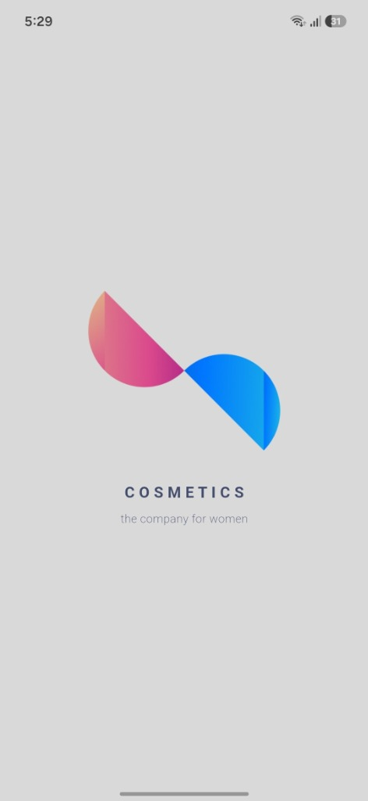
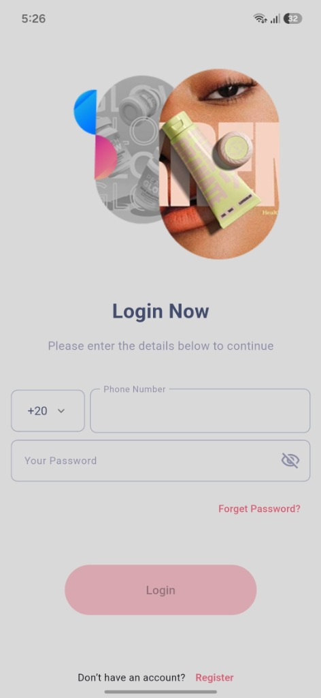
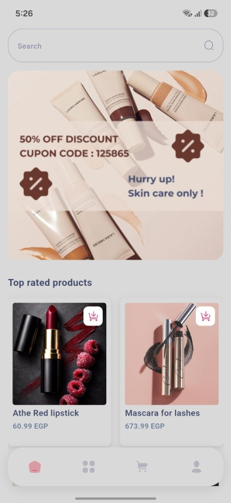
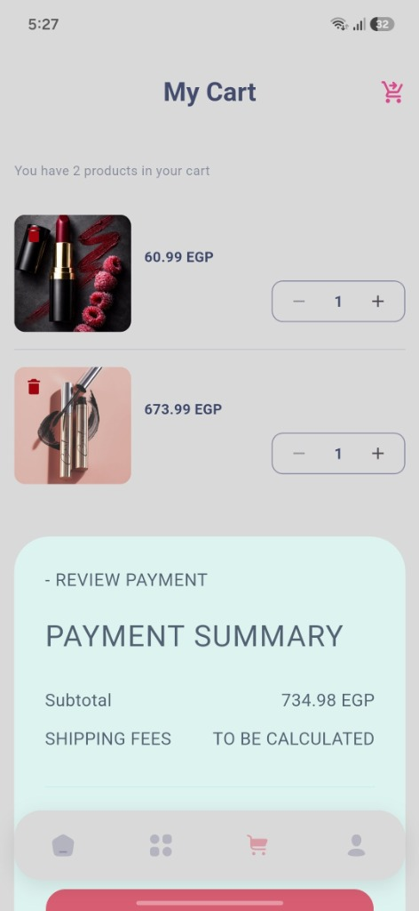

<div align="center">

  <br />

  

  # Avon Cosmetics
  **A Refined Cosmetics & Beauty Shopping Experience**

  <p align="center">
    <em>A modern, cross-platform e-commerce application crafted with Flutter & Dart, engineered under Clean Architecture principles and powered by BLoC / Cubit.</em>
  </p>

  <!-- Badges -->
  <p align="center">
    
    
    
    
    
    
  </p>

  <br />

  <!-- APK Download CTA -->
  <p align="center">
    <a href="https://github.com/Loayy1/Avon_app/raw/main/apk/app-release.apk">
      
    </a>
  </p>

  <sub>📦 Pre-built & ready to install • 52.8 MB • Android 5.0+</sub>

  <br /><br />

</div>

---

## 📱 APK Download & Installation

You can download and run the compiled production release directly on your Android phone without needing to set up Flutter:

* 📥 **[Direct APK Download (app-release.apk)](https://github.com/Loayy1/Avon_app/raw/main/apk/app-release.apk)**
* 📁 **Repository Path:** [`apk/app-release.apk`](apk/app-release.apk)
* 🏷️ **GitHub Releases:** [View Releases](https://github.com/Loayy1/Avon_app/releases)

### 📋 Build Information

| Property | Value |
| :--- | :--- |
| **Application** | Avon Cosmetics |
| **Version** | `1.0.0` (Build `1`) |
| **Package** | `com.example.cosmetics_app` |
| **Format** | Android Application Package (`.apk`) |
| **File Size** | `~52.8 MB` |
| **Compatibility** | Android 5.0 (API 21) &rarr; Android 14 (API 34) |
| **Optimization** | Release mode (R8 minified & tree-shaken) |

> **Installation Note:** If your browser or file manager prompts you during installation, please enable **"Install unknown apps"** in your phone settings.

---

## 📸 Interface Preview

<div align="center">

| Splash & Identity | Secure Login | Discovery & Catalog | Smart Cart & Summary |
| :---: | :---: | :---: | :---: |
|  |  |  |  |
| *Brand introduction* | *Phone & password auth* | *Banners & product cards* | *Real-time invoice calculation* |

</div>

---

## ✨ Features

### 🔐 Authentication & Session
* Phone number and password authentication with client-side validation.
* 4-digit OTP verification flow with resend countdown timer.
* Password lifecycle management (Forgot Password & Password Reset).
* JWT Bearer token auto-injection and persistent session caching.

### 🛍️ Browsing & Catalog
* Dynamic remote marketing carousel for discounts and seasonal offers.
* Category filtering for cosmetics, skincare, and beauty products.
* Responsive product cards displaying imagery, EGP pricing, and stock status.

### 🛒 High-Performance Cart
* **Optimistic UI Updates:** Instant counter and state feedback on add, increment, decrement, and delete actions before network calls resolve.
* **Isolated Button Rebuilds:** Targeted `buildWhen` logic ensures that adding items only triggers the local button loader without redrawing the entire screen.
* **Real-time Invoice:** Automatic evaluation of subtotal, delivery fees, and final checkout totals.

### 💳 Checkout & Profile
* Detailed payment summary with order review.
* Multi-channel payment options (Meeza cards, digital wallets, cash on delivery).
* User profile overview, saved information, and safe sign-out.

---

## 🏗️ Clean Architecture

The codebase follows a **Feature-First Clean Architecture**, separating business rules from frameworks and presentation:

```
┌────────────────────────────────────────────────────────┐
│                   Presentation Layer                   │
│         Screens  •  Widgets  •  Cubit  •  States       │
└───────────────────────────┬────────────────────────────┘
                            │ depends on
                            ▼
┌────────────────────────────────────────────────────────┐
│                      Domain Layer                      │
│            Repository Contracts  •  Entities           │
└───────────────────────────▲────────────────────────────┘
                            │ implements
                            │
┌───────────────────────────┴────────────────────────────┐
│                       Data Layer                       │
│        Remote Data Sources  •  Models  •  Dio          │
└────────────────────────────────────────────────────────┘
```

### 📂 Directory Structure

```
lib/
├── core/                                # Shared Infrastructure
│   ├── error/                           # Failure models & error handling
│   ├── logic/                           # DioHelper & navigation keys
│   ├── network/                         # Remote API endpoints
│   └── storage/                         # CacheHelper (SharedPreferences)
│
└── features/                            # Domain Features
    ├── auth/                            # Login, Register, OTP & Recovery
    ├── cart/                            # Cart management & invoice
    ├── categories/                      # Product category filters
    ├── home/                            # Marketing feed & products
    ├── main/                            # Bottom navigation controller
    └── profile/                         # User profile & settings
```

---

## 🛠️ Tech Stack

| Technology | Purpose |
| :--- | :--- |
| **Flutter & Dart** | Cross-platform native application framework |
| **flutter_bloc / Cubit** | Predictable, unidirectional state management |
| **Dio** | HTTP client with centralized interceptors & token handling |
| **shared_preferences** | Local device persistence for auth credentials |
| **flutter_svg** | Resolution-independent vector graphics rendering |

---

## 👨‍💻 Author & Connect

<div align="center">

### **Loay Mohamed Nader**
*Flutter Mobile Application Developer*

<br />

<p align="center">
  <a href="https://wa.me/loay.mohamedd">
    
  </a>
  &nbsp;
  <a href="https://www.linkedin.com/in/loay-mohamed-621b7a33a">
    
  </a>
  &nbsp;
  <a href="https://github.com/Loayy1">
    
  </a>
</p>

</div>

---

<div align="center">
  <sub>Avon Cosmetics Mobile Application • Built with Flutter & Dart</sub>
</div>
